# SideKix — Flutter demo

[](https://github.com/DavidMorenoEngineer/flutter-demo/actions/workflows/ci.yml)
[](LICENSE)
[](https://flutter.dev)
[](https://flutter.dev/multi-platform)

A small Flutter app that re-creates the [SideKix](https://sidekixhq.com) website — a **responsive** UI with one
section per screen — plus a working **Kix AI chat**: it listens first, asks one good question, then draws a
personalised *Journey Map* right inside the conversation.

> **Unofficial demo.** Built by [David Moreno](https://github.com/DavidMorenoEngineer) as a work sample for a
> founding-engineer application. It is not affiliated with or endorsed by SideKix. Copy and design tokens are
> adapted from the public website; the advisors are fictional; there is no backend and no credentials.

## Demo

[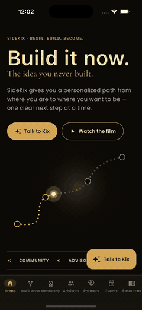](docs/screenshots/ios/demo.mp4)

_iPhone 16 Pro simulator. Click the preview for the full-quality video — it was recorded
[autonomously](#how-the-demos-were-recorded-fully-autonomous): every tab, a flipped advisor card, then a full
conversation with Kix._

## Kix — the AI chat

Kix floats over every screen ("Talk to Kix"), exactly like the website's widget. On phones it opens full-screen;
on wide windows it opens as a floating panel.

| Listens first | Draws the map | Suggests an advisor |
|---------------|---------------|---------------------|
| 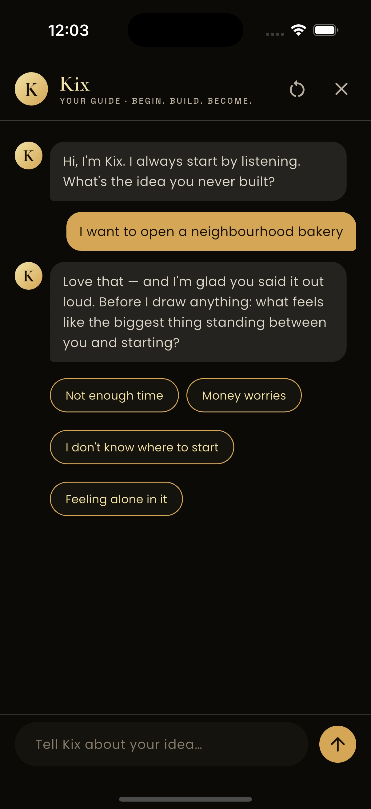 | 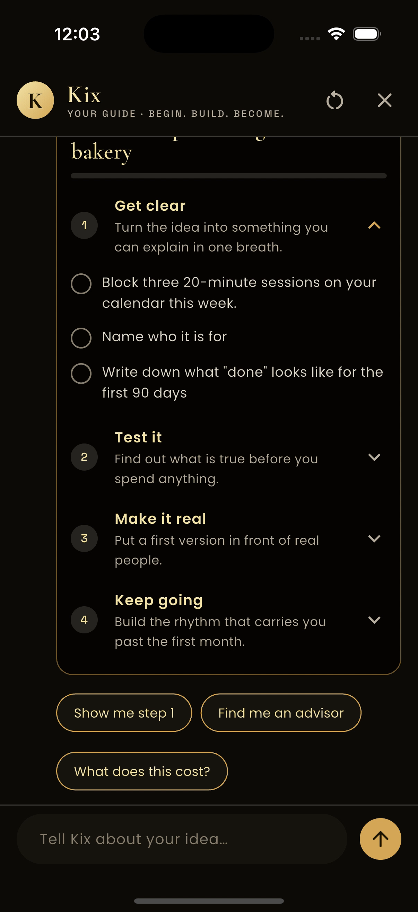 | 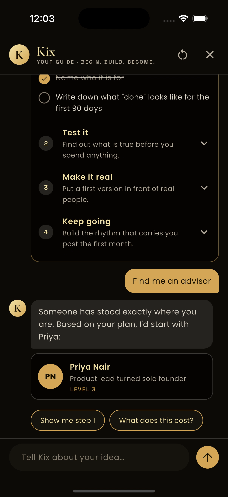 |

- **Streams its reply** token by token, with a typing indicator and quick-reply chips.
- **Asks before it answers.** One clarifying question about what is in your way (time, money, clarity, or
  confidence) — then it commits.
- **Draws a Journey Map in-chat**: four milestones tailored to your idea (food, software, service, product…)
  and your obstacle. Tap a milestone to open its steps and tick them off; progress is tracked in the bloc.
- **Follows up**: "Show me step 1", "Find me an advisor" (suggests a matching advisor card), "What does this
  cost?" (explains credits and tiers, matching the Membership screen).

The model behind it is an **offline, deterministic engine** ([`KixEngine`](lib/features/kix_chat/data/datasources/kix_engine.dart))
so the demo needs no API key. It sits behind a `KixDataSource` interface — the seam where a real LLM client
(streaming SSE from your own backend) would plug in without touching the domain, bloc or UI.

## Responsive by design

One codebase, three layouts, driven by window width ([`breakpoints.dart`](lib/core/layout/breakpoints.dart)):

| Window | Navigation | Content |
|--------|------------|---------|
| **Compact** < 600 | Bottom bar with all **seven** website nav items | 1 column, 20 px gutters |
| **Medium** 600–900 | Bottom bar | 2 columns |
| **Expanded** ≥ 900 | Website-style **top nav** | up to 3 columns, 1120 px max width |

The bottom bar mirrors the site's top navigation exactly — Home · How it works · Membership · Advisors ·
Partners · Events · Resources. (Material's `NavigationBar` caps at five destinations, so it is a purpose-built
equal-width bar.) Grids use equal-height rows and never clip text.

## One section per screen

| Screen | Section adapted from the website | Interaction |
|--------|----------------------------------|-------------|
| **Home** | Hero — *"Build it now."*, keyword band, "The gap" stats | Animated journey path, auto-scrolling band |
| **How it works** | *"Three moves. One momentum."* — Begin · Build · Become | Opens Kix |
| **Membership** | Pricing tiers + Kix credit pack + roadmap | Monthly ⇄ Yearly toggle |
| **Advisors** | *"Meet the Advisors who've been there."* | 3-D flip cards |
| **Partners** | Affiliates · Partners · Sponsors, *"Who is already here"* | — |
| **Events** | *"Opportunities are everywhere."* — browse by state | State filter |
| **Resources** | *"Answers, before you need them."* | Search + category filter |

<details>
<summary>More screenshots (iOS)</summary>

| Home | How it works | Membership | Advisors |
|------|--------------|------------|----------|
| 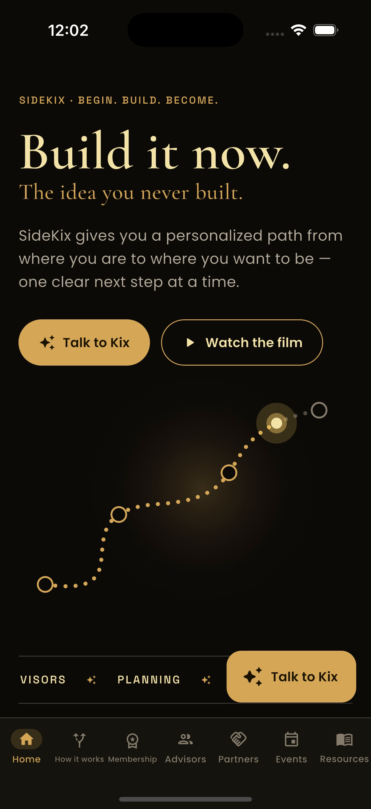 | 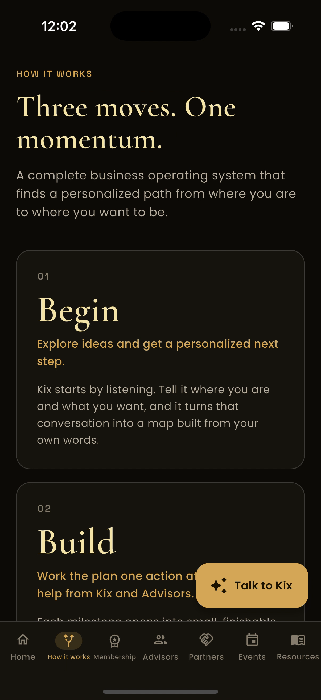 | 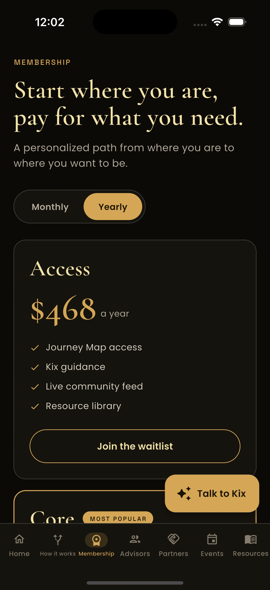 | 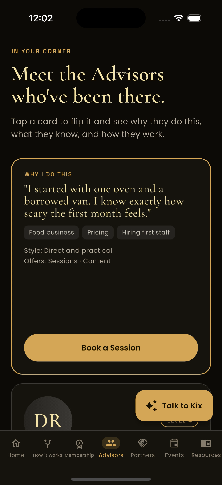 |

| Partners | Events | Resources |
|----------|--------|-----------|
| 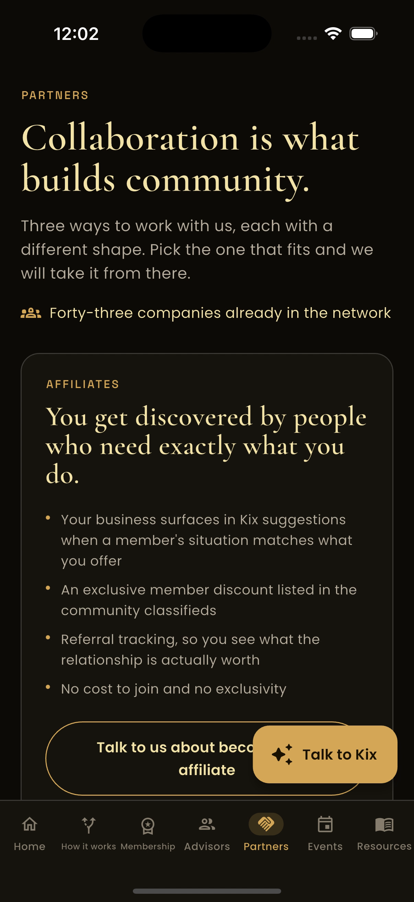 | 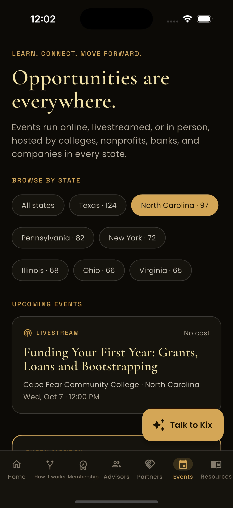 | 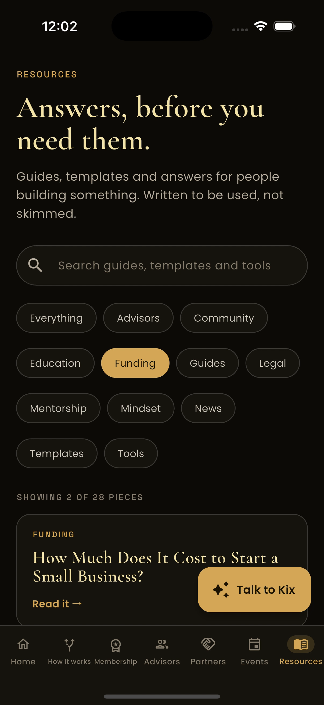 |

</details>

## Architecture

Clean Architecture in three layers per feature, BLoC/Cubit for state:

```
lib/
├── core/
│   ├── di/              # GetIt + injectable (generated config is git-ignored)
│   ├── error/           # Failure — Freezed union, the Left of Either<Failure, T>
│   ├── state/           # Loadable<T> — shared loading | success | failure view state
│   ├── usecase/         # UseCase<T, Params> contract
│   ├── layout/          # Breakpoints / WindowClass
│   ├── theme/           # SxColors (site tokens), SxText (Cormorant · Poppins · Space Grotesk)
│   └── widgets/         # PageBody, SectionHeader, ResponsiveGrid, SxCard, GoldButton, LoadableView
└── features/
    ├── shell/           # AppDestination (7 items), NavigationCubit, bottom/top nav, AppShell
    ├── home/  how_it_works/  membership/  advisors/  partners/  events/  resources/
    │   ├── domain/        # Equatable entities, repository interface, use case
    │   ├── data/          # mock data source + repository impl (TaskEither.tryCatch)
    │   └── presentation/  # Cubit(s) + page(s) + widgets
    └── kix_chat/
        ├── domain/        # ChatMessage, JourneyMap, KixEvent (sealed), StreamKixReply
        ├── data/          # KixEngine (offline model), KixDataSource seam, repository
        └── presentation/  # KixChatBloc (+ Freezed state), panel, bubbles, Journey Map card
```

- **Errors are values.** Repositories return `Future<Either<Failure, T>>` (fpdart); Kix returns
  `Stream<Either<Failure, KixEvent>>`, so a failing model shows a friendly message instead of crashing.
- **Immutable state** with Freezed: `Loadable<T>`, `KixChatState`, and the filter states.
- **`KixEvent` is a sealed class** (`KixToken`, `KixMapReady`, `KixAdvisorSuggested`, `KixQuickReplies`); the bloc
  folds each event into the in-flight message with an exhaustive `switch`.
- **DI** is annotations (`@injectable`, `@LazySingleton(as:)`) + `build_runner`. Cubits are provided above
  `MaterialApp`, so pushed routes (the full-screen chat) can reach them and chat history survives closing.

## Tech stack

| Concern | Choice |
|---------|--------|
| Framework | Flutter 3.47 / Dart |
| State | `flutter_bloc` (Bloc + Cubit), `equatable` |
| DI | `get_it` + `injectable` |
| Immutability / errors | `freezed`, `fpdart` |
| Typography | `google_fonts` — Cormorant Garamond, Poppins, Space Grotesk |
| Tests | `flutter_test`, `bloc_test`, `mocktail`, `integration_test` |

## Tests

```shell
flutter test
```

- **Engine** — listens first, personalises the map by field and obstacle, skips the question when the obstacle
  is already named, follow-ups.
- **Bloc** — welcome state, a two-turn conversation ending in a map, ignores sends while replying, step toggling,
  and a failing model.
- **Responsive widget tests** — phone shows the seven-item bottom bar, desktop shows the top nav, **every screen
  lays out without overflow at 360, 768 and 1440 px**, and a full conversation with Kix produces a Journey Map.

## Run it

```shell
flutter pub get
dart run build_runner build      # generates injectable + freezed code
flutter run                      # any Android emulator or iOS simulator
flutter run -d chrome            # desktop layout; add ?tab=membership to deep-link a screen
flutter build web --release
```

Web deep links: `?tab=home|howItWorks|membership|advisors|partners|events|resources`.

## How the demos were recorded (fully autonomous)

No human touched a device. [`integration_test/demo_test.dart`](integration_test/demo_test.dart) drives the real
app — it taps every tab, flips an advisor card, **types a message to Kix**, answers its question, ticks Journey
Map steps and asks for an advisor — while the platform's own screen recorder runs. Scripts then trim and encode
the footage.

| Step | iOS | Android |
|------|-----|---------|
| Device | iPhone 16 Pro simulator | Pixel 9 emulator |
| Driver | `integration_test` (real clock: `LiveTestWidgetsFlutterBindingFramePolicy.fullyLive`) | same test |
| Recorder | `xcrun simctl io <device> recordVideo` | `adb shell screenrecord` |
| Status | Demo committed | Test passes on a Pixel 9 emulator; the committed demo is iOS (an Android take was lost to an emulator "System UI isn't responding" dialog) |
| Script | [`tool/record_ios.sh`](tool/record_ios.sh) | [`tool/record_android.sh`](tool/record_android.sh) |

[`tool/process_video.sh`](tool/process_video.sh) then trims with `ffmpeg` (filters, not `-ss` — simulator video is
variable-frame-rate), scales to 540 px and exports `demo.mp4` + a palette-optimised `demo.gif`. Screenshots are
single full-resolution frames from the same footage.

```shell
xcrun simctl boot <udid>                                        # ONE emulator/simulator at a time
tool/record_ios.sh <udid> /tmp/ios_raw.mov
tool/process_video.sh /tmp/ios_raw.mov <start-s> <duration-s> docs/screenshots/ios
```

Lessons worth keeping: widget tests can't wait with `Future.delayed` (fake clock) — the driver pumps frames in a
loop inside `tester.runAsync`; and two emulators at once starve memory until the low-memory killer drops the test
connection.

## License

MIT — see [LICENSE](LICENSE).
